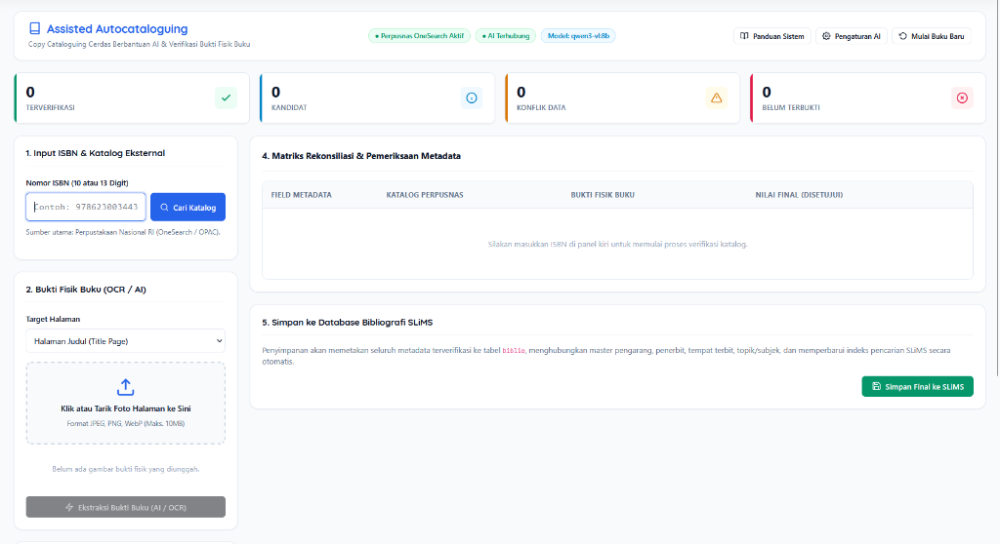
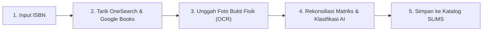

<p align="center">
  <h1 align="center">⚡ Assisted Autocataloguing Plugin Slims</h1>
  <p align="center">
    <strong>Copy Cataloguing Cerdas Berbantuan AI & Verifikasi Bukti Fisik Buku untuk SLiMS 9 Bulian</strong>
  </p>
  <p align="center">
    Terintegrasi dengan <strong>Indonesia OneSearch (Perpusnas RI)</strong>, <strong>Google Books API</strong>, <strong>Tesseract OCR</strong>, dan <strong>Ollama AI Lokal / Cloud AI</strong>.
  </p>
</p>

<p align="center">
  <a href="https://slims.web.id"></a>
  <a href="https://php.net"></a>
  <a href="https://onesearch.id"></a>
  <a href="https://ollama.com"></a>
  <a href="https://github.com/AhmadNadaStudent/Assisted-Autocatalogging-Slims/releases"></a>
  <a href="#lisensi"></a>
</p>

<p align="center">
  
</p>

---

## 📌 Mengapa Plugin Ini Dibuat?

Katalogisasi bahan pustaka fisik sering kali memakan waktu pustakawan:
1. **Pencarian Katalog Lambat & Terblokir**: Pencarian via protokol SRU/OPAC sering terhambat tantangan bot Cloudflare (HTTP 403).
2. **Koreksi Data Manual Membosankan**: Mengetik ulang judul, pengarang, penerbit, dan tahun terbit satu per satu dari buku fisik sangat rawan salah ketik (*human error*).
3. **Kebingungan Buku Multi-Subjek / Interdisipliner**: Sering kali buku membahas lebih dari satu disiplin ilmu (misalnya *Penerapan AI pada Diagnosa Medis*), membingungkan pustakawan dalam menentukan nomor klasifikasi DDC yang paling relevan.
4. **Format Nomor Panggil Berbeda Tiap Perpustakaan**: Standar penulisan *call number* tidak seragam di semua institusi (ada yang memakai format baku Perpusnas `{class} {author} {title}`, ada yang menambahkan tahun, eksemplar, atau kode penerbit).

**Assisted Autocataloguing** hadir menyelesaikan seluruh kendala tersebut dengan pendekatan **Human-in-the-Loop**: Sistem otomatis menarik rekaman resmi, membaca bukti fisik buku via OCR, dan menyajikan rekomendasi klasifikasi multi-perspektif via AI, sementara **Pustakawan tetap menjadi penentu dan pemegang kendali akhir validitas data**.

---

## ✨ Fitur-Fitur Unggulan

| Fitur | Deskripsi |
| :--- | :--- |
| 🔍 **Pencarian ISBN Otomatis Perpusnas** | Terintegrasi langsung dengan **Indonesia OneSearch (IOS - Union Catalog Resmi Perpusnas RI)** berbasis REST API publik yang cepat, stabil, dan 100% bebas blokir Cloudflare. |
| 📖 **Sinkronisasi Abstrak & Cover** | Mengambil otomatis sinopsis buku dan sampul resolusi tinggi dari **Google Books API** atau halaman belakang buku (*back cover OCR*). |
| 📸 **Ekstraksi Bukti Fisik Buku (OCR)** | Unggah foto Halaman Judul, Hak Cipta, atau Daftar Isi. Diekstrak otomatis secara lokal menggunakan **Tesseract OCR** atau Vision AI. |
| ⚖️ **Matriks Rekonsiliasi & Deteksi Konflik** | Tampilan *side-by-side* yang membandingkan metadata Perpusnas dengan bukti fisik buku. Status visual jelas: *Terverifikasi*, *Kandidat*, *Konflik*, atau *Belum Terbukti*. |
| 🧠 **Klasifikasi AI Multi-Kandidat (DDC / 2X0)** | Menganalisis judul, abstrak, dan daftar isi untuk menyajikan opsi klasifikasi alternatif jika buku memiliki topik ganda, lengkap dengan pertimbangan sudut pandangnya (*reasoning*). |
| 🏷️ **Nomor Panggil Standar Perpusnas & Kustom** | Standar baku Perpusnas `{class} {author} {title}` (contoh: `495.1 LIL b`) dilengkapi *builder token* interaktif (`{year}`, `{edition}`, `{copy}`, `{publisher}`) dan **Live Preview**. |
| 🔒 **Privasi 100% Lokal (Ollama)** | Mendukung eksekusi AI lokal penuh (`qwen3-vl:8b`, `gemma4:e4b`, `llama3.2`) tanpa internet. Tersedia juga opsi Cloud AI (OpenAI / 9Router / Gemini). |
| 💾 **Simpan Relasional ke SLiMS** | Sekali klik, langsung memetakan metadata ke tabel `biblio`, `mst_author`, `mst_publisher`, `mst_topic`, mengunduh cover, dan memperbarui indeks pencarian SLiMS. |
| 📚 **Buku Panduan Terintegrasi** | Dilengkapi panduan operasional 5 bab di dalam aplikasi, pencarian topik cepat, dan tombol salin perintah terminal satu-klik. |

---

## 🛠️ Alur Kerja 5 Tahap (Workflow)



1. **Pencarian Katalog**: Pustakawan mengetik ISBN (10 atau 13 digit). Sistem mengunduh metadata bibliografi MARC21/ISBD dari Indonesia OneSearch dan Google Books.
2. **Unggah Bukti Fisik**: Unggah foto Halaman Judul / Hak Cipta (*Copyright Page*) buku.
3. **Ekstraksi Teks**: Tesseract OCR membaca teks halaman buku secara lokal.
4. **Rekonsiliasi & Klasifikasi AI**: Bandingkan data eksternal vs bukti fisik buku. AI merekomendasikan nomor klasifikasi DDC yang cocok. Pustakawan menentukan keputusan akhir (*human-in-the-loop*).
5. **Simpan ke SLiMS**: Rekaman bibliografi otomatis dibuat di pangkalan data SLiMS tanpa perlu ketik ulang dari nol.

---

## 🚀 Petunjuk Instalasi

Tentukan letak folder instalasi SLiMS di server Anda (selanjutnya disebut sebagai `<slims_root>`, contoh: `/var/www/html/slims` di Linux, atau `C:\xampp\htdocs\slims` di Windows).

### Cara 1: Menggunakan Git Clone (Paling Direkomendasikan)
Buka terminal server dan jalankan perintah berikut:
```bash
# Masuk ke direktori plugins SLiMS Anda
cd <slims_root>/plugins/

# Clone repositori ke folder assisted_autocatalogging
git clone https://github.com/AhmadNadaStudent/Assisted-Autocatalogging-Slims.git assisted_autocatalogging
```

### Cara 2: Ekstrak Berkas ZIP Rilis
1. Unduh paket rilis **`assisted_autocatalogging-v1.1.0.zip`** dari menu [Releases](https://github.com/AhmadNadaStudent/Assisted-Autocatalogging-Slims/releases) atau dari direktori `packages/`.
2. Ekstrak berkas zip tersebut ke dalam direktori:
   ```text
   <slims_root>/plugins/assisted_autocatalogging/
   ```
3. Pastikan berkas `assisted_autocatalogging.plugin.php` berada tepat di:
   ```text
   <slims_root>/plugins/assisted_autocatalogging/assisted_autocatalogging.plugin.php
   ```

### Cara 3: Mode Development (Symlink / Directory Junction)
Bila Anda mengembangkan plugin pada folder lokal terpisah:
- **Di Linux / macOS**:
  ```bash
  ln -s /path/ke/folder_project/ <slims_root>/plugins/assisted_autocatalogging
  ```
- **Di Windows (CMD / PowerShell as Administrator)**:
  ```powershell
  cmd /c mklink /J "<slims_root>\plugins\assisted_autocatalogging" "<path_ke_folder_project>"
  ```

---

## ⚙️ Mengaktifkan Plugin di Admin SLiMS

1. Masuk ke halaman admin SLiMS (`admin/index.php`) sebagai Administrator.
2. Buka menu **Sistem** (*System*) → **Plugin** (*Plugins*).
3. Cari plugin bernama **Assisted Autocataloguing** (Versi 1.0.0).
4. Klik tombol toggle **Aktifkan** (*Enable*).
5. Menu **Assisted Autocataloguing** akan langsung muncul di bawah modul **Bibliografi** pada menu navigasi admin SLiMS.
6. Pastikan folder penyimpanan memiliki izin tulis (*write permission*):
   ```bash
   chmod -R 775 <slims_root>/plugins/assisted_autocatalogging/storage/
   ```

---

## 🧠 Konfigurasi Model AI (Ollama Lokal / Cloud)

Plugin ini dapat berjalan langsung tanpa AI (menggunakan heuristik regex bawaan), atau dihubungkan ke AI untuk penalaran DDC cerdas:

### 1. AI Lokal Gratis & Bebas Internet (Ollama)
1. Pasang Ollama dari [ollama.com](https://ollama.com).
2. Unduh model rekomendasi melalui terminal:
   ```bash
   # Rekomendasi: Model teks sangat cepat untuk klasifikasi DDC
   ollama run gemma4:e4b

   # Alternatif model teks ringan
   ollama run llama3.2

   # Model vision multimodal (membaca gambar bukti fisik langsung)
   ollama run qwen3-vl:8b
   ```
3. Buka menu **Pengaturan AI** di pojok kanan atas plugin:
   - **Mode AI**: `Local-Only (Ollama Lokal Saja — Privasi Penuh)`
   - **Ollama Base URL**: `http://localhost:11434`
   - **Model Name**: `gemma4:e4b` atau `qwen3-vl:8b`
   - **Timeout**: `120` detik

### 2. Cloud AI (OpenAI / 9Router / Gemini)
1. Buka menu **Pengaturan AI**:
   - **Mode AI**: `Cloud AI`
   - **Base URL**: `https://api.openai.com/v1` (atau endpoint 9Router Anda)
   - **API Key**: Masukkan API Key Anda
   - **Model Name**: `gpt-4o-mini`, `gemini-2.5-flash`, atau model kompatibel lainnya.

---

## 📋 Persyaratan Sistem

- **SLiMS**: SLiMS 9 Bulian (v9.0 ke atas, teruji optimal pada SLiMS 9.8.0 Bulian).
- **PHP**: Versi 8.1, 8.2, 8.3, atau 8.4.
  - Ekstensi PHP wajib: `pdo_mysql`, `mysqli`, `curl`, `gd`, `fileinfo`, `mbstring`, `json`, `libxml`.
- **Database**: MySQL 5.7+ / MySQL 8.0+ / MariaDB 10.3+.
- **Mesin OCR (Opsional)**:
  - Tesseract OCR (`tesseract` binary pada sistem PATH), ATAU
  - Python 3.8+ dengan library OCR, ATAU
  - Verifikasi manual gambar tanpa OCR.

---

## 📂 Struktur Direktori Proyek

```text
assisted_autocatalogging/
├── assisted_autocatalogging.plugin.php    # Deklarasi resmi plugin SLiMS
├── index.php                             # Router halaman admin SLiMS
├── api.php                               # Endpoint AJAX terlindungi CSRF & SLiMS Auth
├── config/
│   ├── config.default.php                # Template konfigurasi default sistem
│   └── config.php                        # Konfigurasi aktif lokal (auto-generated)
├── src/
│   ├── Ai/                               # Adapter Ollama, OpenAI-compatible, Schema Validator
│   ├── Catalog/                          # Adapter Indonesia OneSearch Perpusnas, Google Books, SRU
│   ├── Core/                             # Application container, Request, Response, Security CSRF
│   ├── Metadata/                         # InternalBiblioModel, EvidenceLedger, Reconciler
│   ├── Ocr/                              # Preprocessor GD, Tesseract Engine, Python Bridge
│   └── Slims/                            # Mapper bibliografi, Master Data Resolver, Persistence PDO
├── assets/
│   ├── css/app.css                       # Desain antarmuka modern serasi SLiMS 9
│   └── js/app.js                         # Logika reaktif AJAX & rekonsiliasi matriks
├── templates/
│   └── main_layout.php                   # Tata letak panel kerja & modal dialog
├── storage/
│   ├── uploads/                          # Direktori unggahan foto bukti fisik (.htaccess protected)
│   └── logs/                             # Log operasional sistem
├── docs/
│   └── images/                           # Tangkapan layar antarmuka dokumentasi
└── README.md                             # Dokumentasi proyek komprehensif
```

---

## 🤝 Kontribusi & Dukungan Komunitas

Kontribusi terhadap pengembangan plugin ini sangat disambut hangat!
* 🐛 **Laporkan Masalah**: Silakan buka [GitHub Issues](https://github.com/AhmadNadaStudent/Assisted-Autocatalogging-Slims/issues) jika Anda menemukan kendala atau *bug*.
* 💡 **Permintaan Fitur**: Ingin menambahkan format nomor panggil institusi Anda atau sumber katalog baru? Buka diskusi di [GitHub Discussions](https://github.com/AhmadNadaStudent/Assisted-Autocatalogging-Slims/discussions).
* 🔀 **Pull Request**: *Fork* repositori ini, buat branch fitur Anda, dan kirimkan *Pull Request*.

---

## 📄 Lisensi

Plugin ini dirilis di bawah lisensi terbuka [GPL-3.0 License](https://www.gnu.org/licenses/gpl-3.0.html) agar sejalan dengan filosofi keterbukaan ekosistem **SLiMS (Senayan Library Management System)**.

---

<p align="center">
  Dibuat dengan ❤️ untuk seluruh Pustakawan dan Pengelola Perpustakaan Indonesia 🇮🇩<br>
  <strong>Assisted Autocataloguing — Katalogisasi Cepat, Tepat, dan Terverifikasi.</strong>
</p>

<!-- SEO Keywords: slims, slims9, slims-plugin, slims-bulian, library-automation, copy-cataloging, perpustakaan-nasional, indonesia-onesearch, perpusnas, ollama-ai, tesseract-ocr, dewey-decimal-classification, ddc, senayan-library-management-system, pustakawan-indonesia -->
